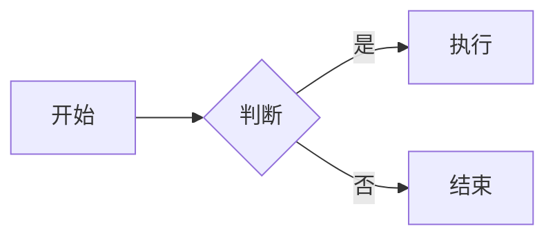

# Konai 示例文档

欢迎使用 **Konai** —— 一个完全免费、零激活的 Markdown 编辑器。

## 表格

| 功能 | 状态 | 说明 |
| :--- | :---: | ---: |
| 表格 | 可用 | 支持对齐与增删行列 |
| 任务列表 | 可用 | 点击复选框切换 |
| 代码高亮 | 可用 | CodeMirror 6 |

## 数学公式

行内公式：$E = mc^2$ 与 $a^2 + b^2 = c^2$。

块级公式：

$$
\int_0^1 x^2 \, dx = \frac{1}{3}
$$

## Mermaid 图表



## 代码块

```js
function hello(name) {
  return `Hello, ${name}!`
}
```

## 列表与任务

- 无序列表项
  - 缩进子项

1. 有序列表项一
2. 有序列表项二

- [x] 已完成的任务
- [ ] 未完成的任务（点击左侧复选框切换）

## 引用与脚注

> 引用块第一层
> > 引用块第二层

脚注示例[^1]。

[^1]: 这是脚注内容。

## 行内样式

**粗体**、*斜体*、***粗斜体***、~~删除线~~、`行内代码`、[链接](https://example.com)。

## 目录

[toc]
